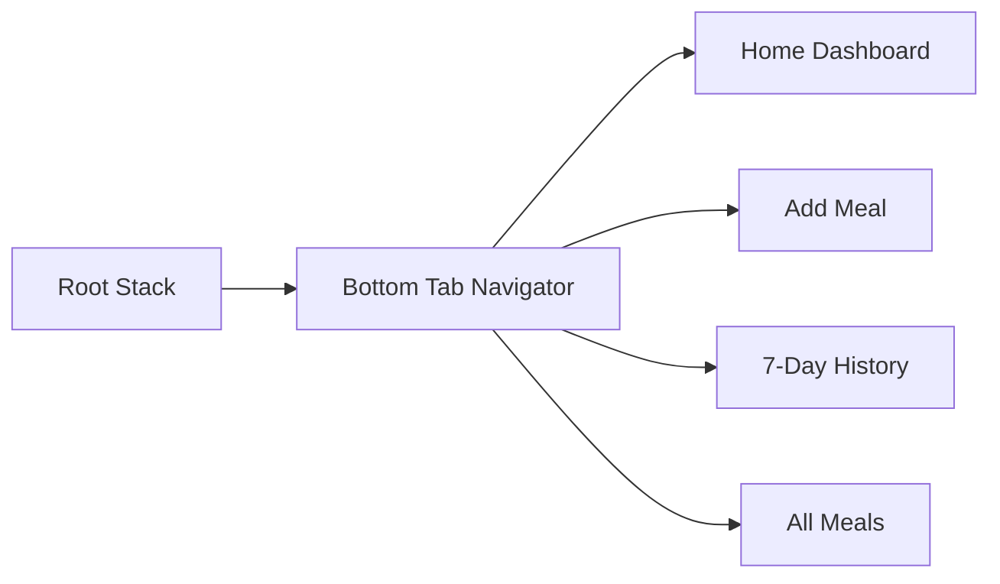
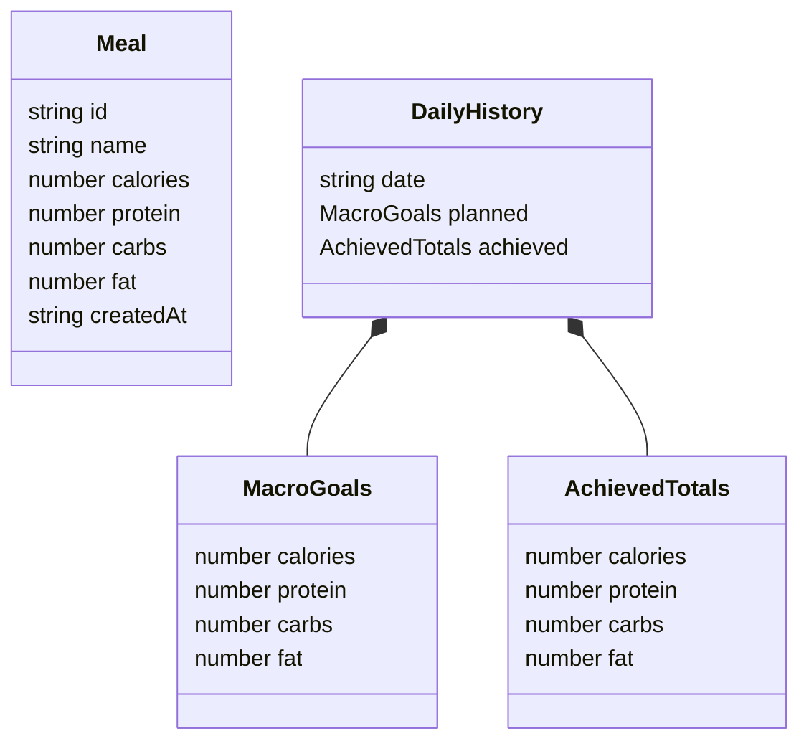
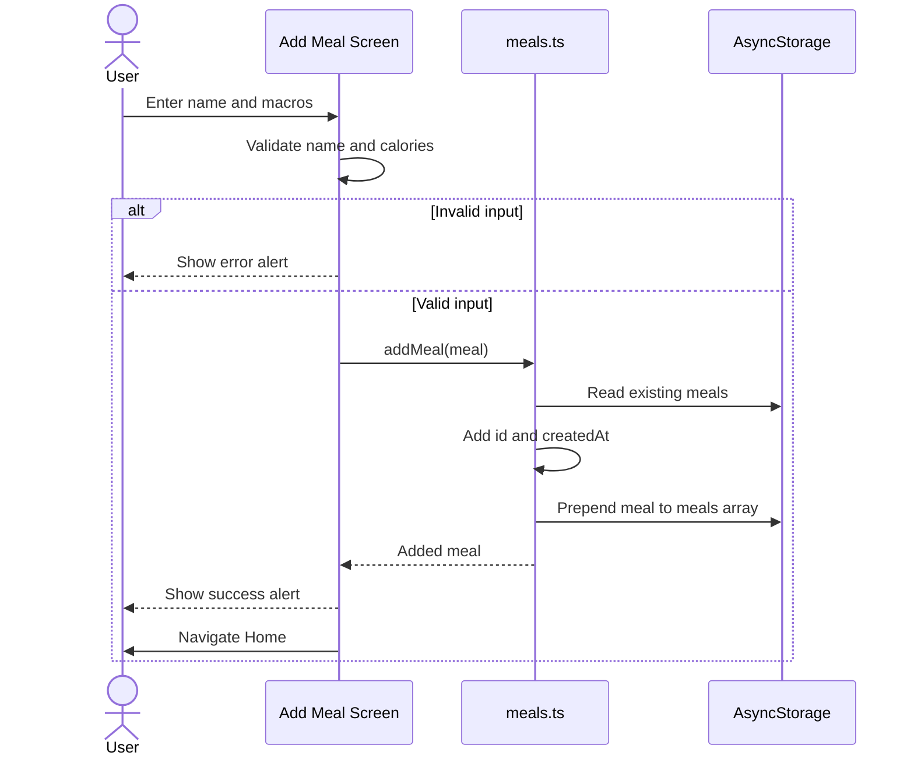
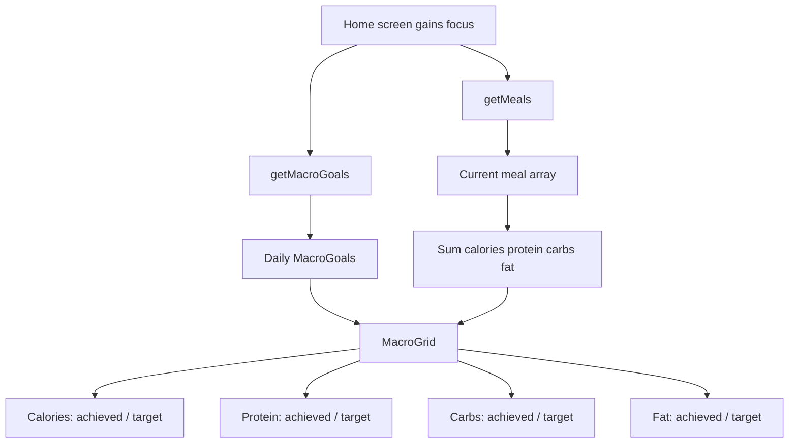
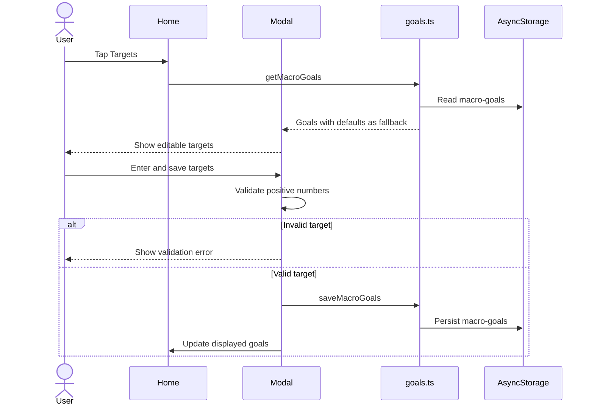
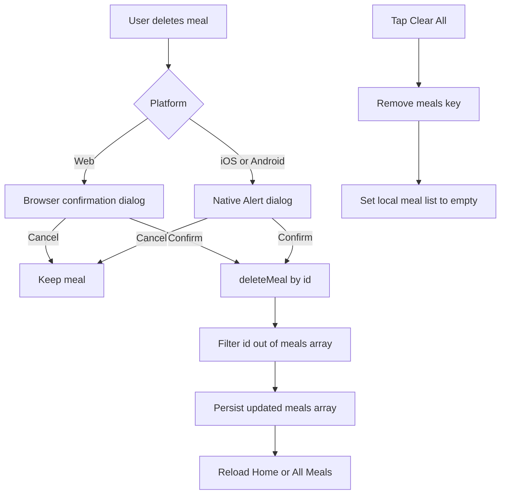
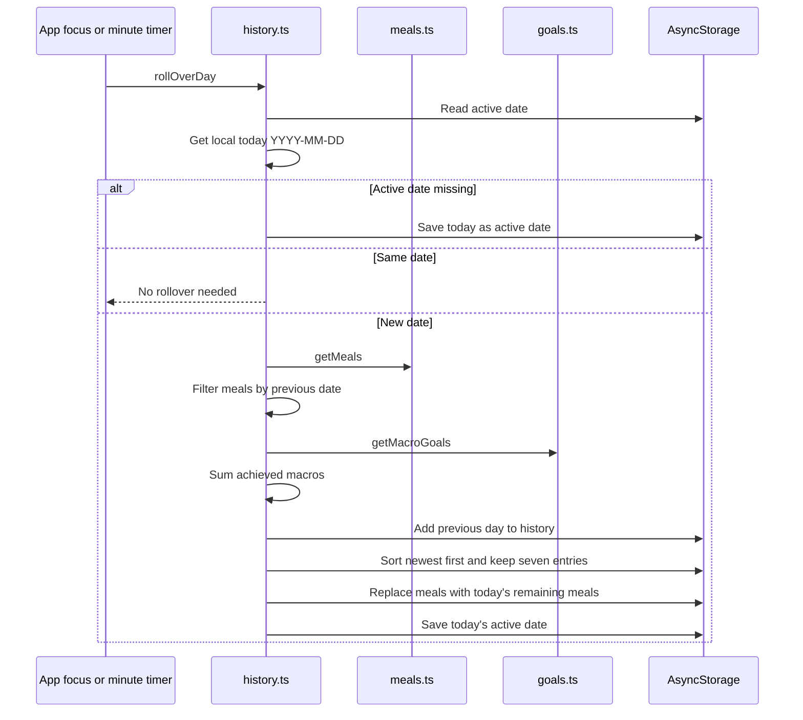

# MacroMuse ✨

MacroMuse is a cross-platform Expo/React Native macro-tracking app with a soft pink, girly visual style. It supports logging meals, viewing daily totals, setting personal targets, deleting or clearing meals, and reviewing planned-versus-achieved totals over the latest seven completed days.

## Features

- **Home dashboard:** shows calories, protein, carbs, and fat totals for meals logged today.
- **Add Meal:** validates the meal name and calories, then saves numeric macro values.
- **All Meals:** lists today's meals, supports individual deletion, and can clear all meals.
- **Personal targets:** a modal lets the user customize all four daily goals.
- **7-Day History:** stores completed days and displays achieved amounts against planned targets.
- **Automatic rollover:** checks for a new local calendar day on app focus and every minute while the home screen is open.
- **Cross-platform interactions:** native alerts on iOS/Android and browser confirmation dialogs on web.

## Tech stack

- Expo SDK 55
- React Native 0.83
- React 19
- Expo Router
- AsyncStorage
- React Native StyleSheet
- TypeScript

## Getting started

```bash
npm install
npx expo start
```

Useful alternatives:

```bash
npx expo start --ios
npx expo start --android
npx expo start --web
npx tsc --noEmit
npx expo lint
```

## Navigation

Expo Router provides a tab-based app shell. The tabs are **Home**, **Add Meal**, **History**, and **All Meals**.



## Project structure

```text
src/
├── app/
│   ├── _layout.tsx              # Root stack navigator
│   └── (tabs)/
│       ├── _layout.tsx          # Bottom tab navigator
│       ├── index.tsx            # Home dashboard and target modal
│       ├── add-meal.tsx         # Meal entry form
│       ├── history.tsx          # Seven-day planned vs. achieved view
│       └── meals.tsx            # Complete meal list and clear action
├── components/
│   ├── HomeHeader.tsx
│   ├── MacroCard.tsx
│   ├── MacroGrid.tsx
│   ├── MealItem.tsx
│   └── RecentMeals.tsx
├── storage/
│   ├── meals.ts                 # Meal CRUD and AsyncStorage persistence
│   ├── goals.ts                 # Personal target persistence
│   └── history.ts               # Daily rollover and seven-day history
└── styles/
    └── global.ts                # Shared palette and base styles
```

## Data model



## Persistent storage

| AsyncStorage key | Purpose |
|---|---|
| `meals` | Current day's meal objects |
| `macro-goals` | User-selected daily targets |
| `macro-history` | Up to seven completed daily history entries |
| `macro-active-date` | Local `YYYY-MM-DD` date used to detect rollover |

## Feature flows

### Add a meal

The form requires a meal name and calories. Protein, carbs, and fat default to zero when left blank.



### Calculate dashboard totals

Each focus on Home reloads the current meal list and personal targets. `MacroGrid` reduces the list into four totals and passes each total and target to `MacroCard`.



### Set personal targets

The target modal opens with the user's saved values. Saving validates that every target is a positive finite number before writing it to storage.



### Delete and clear meals

A meal can be deleted by tap/long-press, while All Meals can remove the entire current list.



### Automatic daily rollover

Rollover uses the device's local calendar date, not UTC. On the first launch, it records today's date. On a later date, it archives meals created on the previous active date, compares them with the targets saved for that day, clears that day's meal list, and advances the active date.



> Current limitation: if the app is closed for multiple calendar days, rollover archives one immediately previous active date rather than recreating a separate entry for every missed day.

### View seven-day history

The History tab executes rollover first, so opening it after midnight will archive the prior day before displaying records. Each entry shows progress bars for calories, protein, carbs, and fat; an achieved amount above a target is visually capped at 100% in the bar while the exact achieved/planned text remains visible.

```mermaid
flowchart TD
    Open[Open History tab] --> Rollover[Run rollOverDay]
    Rollover --> Read[getHistory]
    Read --> Entries[Newest history entries]
    Entries --> Limit[Keep at most seven]
    Limit --> Empty{Any entries?}
    Empty -->|No| EmptyState[Show start-history message]
    Empty -->|Yes| Cards[Render one card per day]
    Cards --> Each[For each macro]
    Each --> Text[Show achieved / planned]
    Each --> Progress[Calculate achieved / planned percent]
    Progress --> Bar[Render capped progress bar]
